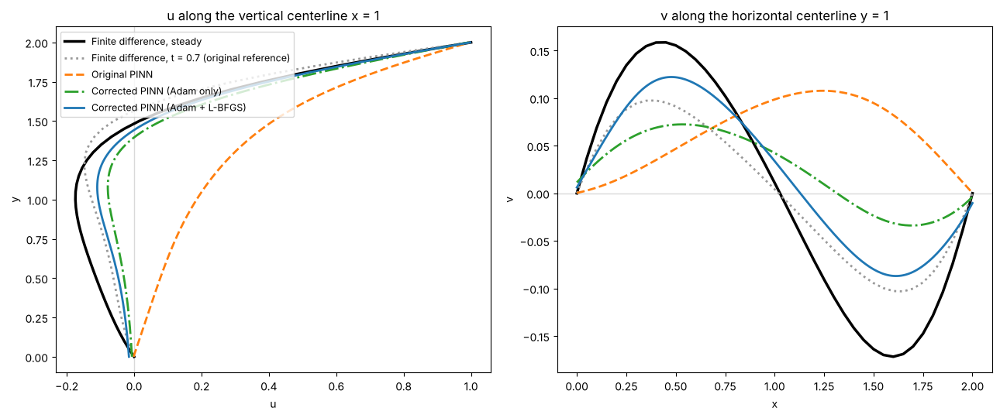
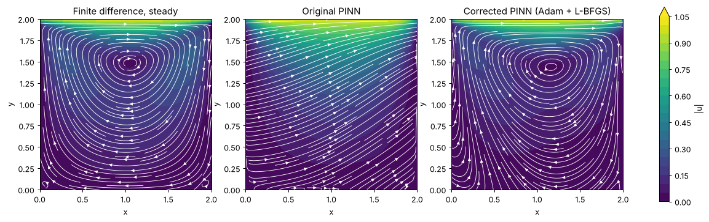

 # PINNs Solver for Different Partial Differential Equations

## 1. Klein-Gordon Equation

### Case 1
Let $$\( a \in \mathbb{R} \)$$ and \( b > 0 \). The equation is:

$$
\left(\partial_t^2 - a^2 \nabla^2 + b \right)\psi(x,t) = 0, \quad (x,t) \in [1, 5] \times [0,T],
$$

with initial conditions:

$$
\psi(x,0) = a \cos\left(\frac{\pi}{2} x \right), \quad \psi_t(x,0) = b\mu \cos\left(\frac{\pi}{2}x\right),
$$

and Dirichlet boundary conditions:

$$
\psi(1,t) = \psi(5,t) = 0,
$$

where:

$$
\mu = \sqrt{b + \frac{a^2 \pi^2}{4}}.
$$

The exact solution is:

$$
\psi(x,t) = \cos\left(\frac{\pi x}{2}\right) \left(a \cos\left(\mu t\right) + b \sin\left(\mu t\right)\right).
$$

### Case 2
Let $$\( a \in \mathbb{R} \)$$ and $$\( b > 0 \)$$. The equation is:

$$
\left(\partial_t^2 - a^2 \nabla^2 + b \right)\psi(x,t) = 0, \quad (x,t) \in [0, 4] \times [0,T],
$$

with initial conditions:

$$
\psi(x,0) = a e^{-\frac{\pi x}{2}}, \quad \psi_t(x,0) = b\mu e^{-\frac{\pi}{2} x},
$$

and boundary conditions:

$$
\psi(0,t) = a \cos(\mu t) + b \sin(\mu t), \quad \psi(4,t) = e^{-2\pi}\left(a \cos(\mu t) + b \sin(\mu t)\right),
$$

where:

$$
\mu = \sqrt{b - \frac{a^2 \pi^2}{4}}.
$$

The exact solution is:

$$
\psi(x,t) = e^{-\frac{\pi}{2} x} \left( a \cos(\mu t) + b \sin(\mu t) \right).
$$

## 2. Lid-Driven Cavity Problem

The equations governing the lid-driven cavity problem are:

$$
\frac{\partial u}{\partial t} + u \frac{\partial u}{\partial x} + v \frac{\partial u}{\partial y} = -\frac{1}{\rho}\frac{\partial p}{\partial x} + \nu \left( \frac{\partial^2 u}{\partial x^2} + \frac{\partial^2 u}{\partial y^2} \right),
$$

$$
\frac{\partial v}{\partial t} + u \frac{\partial v}{\partial x} + v \frac{\partial v}{\partial y} = -\frac{1}{\rho}\frac{\partial p}{\partial y} + \nu \left( \frac{\partial^2 v}{\partial x^2} + \frac{\partial^2 v}{\partial y^2} \right),
$$

$$
\frac{\partial^2 p}{\partial x^2} + \frac{\partial^2 p}{\partial y^2} = -\rho \left( \left(\frac{\partial u}{\partial x}\right)^2 + 2 \frac{\partial u}{\partial y}\frac{\partial v}{\partial x} + \left(\frac{\partial v}{\partial y}\right)^2 \right).
$$

The initial condition is:

$$
u, v, p = 0 \quad \text{everywhere},
$$

and the boundary conditions are:

- \( u = 1 \) at \( y = 2 \) (moving lid at the top boundary),
- \( u = v = 0 \) on all other boundaries (no-slip condition),
- $$\( \frac{\partial p}{\partial y} = 0 \) at \( y = 0 \) \textit{(bottom boundary, no vertical pressure gradient)}$$,
- \( p = 0 \) at \( y = 2 \) (pressure is zero at the top boundary),
- $$\( \frac{\partial p}{\partial x} = 0 \) at \( x = 0, 2 \) \textit{(no horizontal pressure gradient at the side walls)}$$.

## Lid-driven cavity: corrected version (`lid_driven_cavity/`)

The cavity section of `PINNS.ipynb` had several problems, fixed in [`lid_driven_cavity/Lid_Driven_Cavity_PINN.ipynb`](lid_driven_cavity/Lid_Driven_Cavity_PINN.ipynb):

- The PINN takes only $(x, y)$, so it solves the **steady** equations, but its finite-difference reference stopped at $t = 0.7$, which is still transient. The reference is now run to steady state ($t \approx 5.9$).
- The **continuity equation** $u_x + v_y = 0$ was missing from the loss, so the velocity field was never forced to be divergence-free. The loss is now x-momentum + y-momentum + continuity.
- The two top corners were in both the lid set ($u = 1$) and the side-wall sets ($u = 0$). They now belong only to the walls.
- 101 boundary points per wall (was 10) with a boundary-loss weight of 10; the learning-rate schedule is actually used; training finishes with **L-BFGS** after Adam.

Steady case, $\rho = 1$, $\nu = 0.1$ ($Re = 20$), compared with a 41×41 finite-difference solution at steady state (relative L2 error, interior points):

| | u | v | p | u on centerline x = 1 | v on centerline y = 1 |
|---|---|---|---|---|---|
| Original PINN | 1.19 | 1.32 | 1.27 | 0.95 | 1.29 |
| Corrected PINN, Adam only | 0.40 | 0.73 | 0.97 | 0.24 | 0.73 |
| Corrected PINN, Adam + L-BFGS | 0.21 | 0.40 | 0.49 | 0.17 | 0.42 |

The original network does not form the cavity vortex at all; the corrected one does, and the L-BFGS stage roughly halves the error left by Adam. The remaining error is concentrated at the lid corners, where the velocity jumps from 1 to 0 and the pressure is singular.

The notebook loads the trained weights in `lid_driven_cavity/weights/` by default; set `TRAIN = True` to retrain. `train_original.py` retrains the original network from `PINNS.ipynb` for the comparison.
